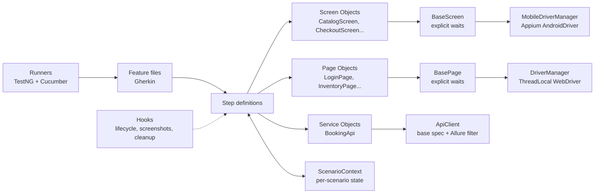

# Mobile, API & Web Test Automation Framework


A BDD test automation framework covering **Android mobile**, **REST API** and **Web UI**
testing, built with Java, Cucumber, TestNG, Appium, RestAssured, Selenium and Allure.

The architecture is based on patterns I use day to day as a QA engineer on a mobile banking
product. I rebuilt them from scratch here against public demo applications.

| Layer | System under test | Scenarios |
|---|---|---|
| 📱 Mobile | [Sauce Labs My Demo App](https://github.com/saucelabs/my-demo-app-android) (Android) | 9 |
| 🔌 API | [Restful Booker](https://restful-booker.herokuapp.com/apidoc/index.html) (hotel booking REST API) | 12 |
| 🌐 Web | [Sauce Demo](https://www.saucedemo.com) (e-commerce web app) | 11 |

---

## ✨ Highlights

- **BDD with Cucumber**: test cases written in Gherkin (Given / When / Then) and readable by non-engineers, with test case IDs as tags (`@TC-MOB-006`) for traceability to a test management tool
- **One architecture, three platforms**: Feature → Steps → Screen/Page/Service Object → Base class → Driver
- **Explicit waits only**: no `Thread.sleep` anywhere (see [Waiting strategy](#%EF%B8%8F-waiting-strategy))
- **Retry of failed scenarios**: the `rerun` plugin plus dedicated "Failed" runners
- **Parallel execution** for API & Web: `ThreadLocal` drivers and per-scenario state through PicoContainer dependency injection
- **Self-cleaning API tests**: bookings created in a scenario are deleted in an `@After` hook
- **JSON Schema validation** of API responses
- **Screenshot on failure** (web & mobile) attached to the report
- **CI pipeline**: dry-run gate, full run, retry, Allure report, and nightly schedule

---

## 📝 Test scenarios (Gherkin)

Feature files are the single source of truth for the test cases: they are both the
documentation and the executable test. Below are representative examples; every
scenario is linked in the [full list](#-full-test-case-list).

### 📱 Mobile: end-to-end checkout (DataTables)

```gherkin
@mobile
Feature: Login & Checkout - My Demo App (Android)

  Background:
    Given I open the app on the catalog screen

  @TC-MOB-006 @smoke
  Scenario: Complete checkout end to end
    Given I have "Sauce Labs Backpack" in my mobile cart
    When I proceed to checkout from the mobile cart
    And I log in on mobile as the default user
    And I submit the shipping address:
      | fullName | Raihan Tester  |
      | address  | Jl. Sudirman 1 |
      | city     | Jakarta        |
      | zipCode  | 10220          |
      | country  | Indonesia      |
    And I submit the payment details:
      | cardHolder     | Raihan Tester    |
      | cardNumber     | 4111111111111111 |
      | expirationDate | 0330             |
      | securityCode   | 123              |
    And I place the order
    Then I should see the "Checkout Complete" confirmation
```

### 📱 Mobile: negative login (Scenario Outline)

```gherkin
  @TC-MOB-005 @negative
  Scenario Outline: Login is rejected - <case>
    Given I open the login screen from the menu
    When I log in on mobile with username "<username>" and password "<password>"
    Then I should see the mobile login error "<error>"

    Examples:
      | case            | username          | password | error                                |
      | empty username  |                   | 10203040 | Username is required                 |
      | empty password  | bod@example.com   |          | Enter Password                       |
      | locked out user | alice@example.com | 10203040 | Sorry this user has been locked out. |
```

### 🔌 API: create and delete a booking

```gherkin
@api
Feature: Booking API - Restful Booker

  @TC-API-001 @smoke
  Scenario: Create a new booking with valid data
    When I create a booking with the following details:
      | firstName       | Jim        |
      | lastName        | Brown      |
      | totalPrice      | 250        |
      | depositPaid     | true       |
      | checkIn         | 2027-01-10 |
      | checkOut        | 2027-01-15 |
      | additionalNeeds | Breakfast  |
    Then the response status code should be 200
    And the response should match the "create-booking" JSON schema
    And the created booking should contain the submitted details

  @TC-API-007
  Scenario: Delete a booking
    Given a booking exists for guest "Delete" "Me"
    And I am authenticated as admin
    When I delete the booking
    # Restful Booker returns 201 (not 200/204) on a successful delete - documented API behaviour
    Then the response status code should be 201
    And retrieving the booking should return status code 404
```

### 🌐 Web: shopping flow (Background + DataTable list)

```gherkin
@web
Feature: Shopping & Checkout - Sauce Demo

  Background:
    Given I am logged in as "standard_user"

  @TC-WEB-004
  Scenario: Add multiple products to the cart
    When I add the following products to the cart:
      | Sauce Labs Backpack     |
      | Sauce Labs Bike Light   |
      | Sauce Labs Bolt T-Shirt |
    Then the cart badge should show 3
    And the cart should contain:
      | Sauce Labs Backpack     |
      | Sauce Labs Bike Light   |
      | Sauce Labs Bolt T-Shirt |
```

### 📋 Full test case list

Click an ID to open its Gherkin scenario.

| ID | Area | Scenario | Type |
|---|---|---|---|
| [TC-MOB-001](src/test/resources/features/mobile/catalog.feature#L10) | Catalog | Catalog is displayed when the app is opened | Positive |
| [TC-MOB-002](src/test/resources/features/mobile/catalog.feature#L15) | Catalog | Sort by price low → high | Positive |
| [TC-MOB-003](src/test/resources/features/mobile/catalog.feature#L20) | Catalog | Sort by name Z → A | Positive |
| [TC-MOB-004](src/test/resources/features/mobile/cart.feature#L10) | Cart | Add product with quantity 2, verify badge, items & total | Positive |
| [TC-MOB-005](src/test/resources/features/mobile/login_checkout.feature#L10) | Login | Empty username / empty password / locked user (3 cases) | Negative |
| [TC-MOB-006](src/test/resources/features/mobile/login_checkout.feature#L22) | Checkout | End-to-end: cart → login → address → payment → order | Positive |
| [TC-MOB-007](src/test/resources/features/mobile/login_checkout.feature#L41) | Checkout | Empty shipping address is rejected | Negative |
| [TC-API-001](src/test/resources/features/api/booking.feature#L7) | Booking | Create booking (schema + body check) | Positive |
| [TC-API-002](src/test/resources/features/api/booking.feature#L21) | Booking | Get booking by id | Positive |
| [TC-API-003](src/test/resources/features/api/booking.feature#L29) | Booking | Search bookings by guest name | Positive |
| [TC-API-004](src/test/resources/features/api/booking.feature#L36) | Booking | Full update (PUT) with token | Positive |
| [TC-API-005](src/test/resources/features/api/booking.feature#L45) | Booking | Partial update (PATCH) with token | Positive |
| [TC-API-006](src/test/resources/features/api/booking.feature#L53) | Booking | Update with invalid token → 403 | Negative |
| [TC-API-007](src/test/resources/features/api/booking.feature#L59) | Booking | Delete booking, then verify 404 | Positive |
| [TC-API-008](src/test/resources/features/api/booking.feature#L68) | Booking | Get non-existing booking → 404 | Negative |
| [TC-API-009](src/test/resources/features/api/auth.feature#L5) | Auth | Create token with valid credentials | Positive |
| [TC-API-010](src/test/resources/features/api/auth.feature#L11) | Auth | Invalid credentials (3 cases) | Negative |
| [TC-WEB-001](src/test/resources/features/web/login.feature#L10) | Login | Successful login | Positive |
| [TC-WEB-002](src/test/resources/features/web/login.feature#L15) | Login | Locked / wrong / empty credentials (4 cases) | Negative |
| [TC-WEB-003](src/test/resources/features/web/shopping.feature#L10) | Cart | Add one product | Positive |
| [TC-WEB-004](src/test/resources/features/web/shopping.feature#L17) | Cart | Add multiple products | Positive |
| [TC-WEB-005](src/test/resources/features/web/shopping.feature#L29) | Inventory | Sort by price low → high | Positive |
| [TC-WEB-006](src/test/resources/features/web/shopping.feature#L34) | Inventory | Sort by name Z → A | Positive |
| [TC-WEB-007](src/test/resources/features/web/shopping.feature#L39) | Checkout | End-to-end checkout | Positive |
| [TC-WEB-008](src/test/resources/features/web/shopping.feature#L47) | Checkout | Missing postal code | Negative |

**32 executable scenarios** in total (Scenario Outline examples included).

---

## 🏗️ Architecture



```
src
├── main/java
│   ├── core/            ConfigReader, DriverManager, MobileDriverManager, BasePage, BaseScreen
│   ├── screens/         Mobile Screen Objects (My Demo App)
│   ├── pages/           Web Page Objects (Sauce Demo)
│   └── api/             ApiClient, BookingApi, models (Java records)
└── test
    ├── java
    │   ├── context/     ScenarioContext (DI-shared state), TestDataFactory
    │   ├── hooks/       MobileHooks (@mobile), WebHooks (@web), ApiHooks (@api)
    │   ├── steps/       mobile/, api/, web/ step definitions
    │   └── runners/     Mobile/Api/WebRunner, Failed*Runner, DryRunRunner
    └── resources
        ├── features/    mobile/, api/, web/ *.feature
        ├── schemas/     JSON schemas
        └── config.properties
```

---

## ▶️ Running the tests

**Requirements:** JDK 21+, Maven 3.9+, Google Chrome. Browser drivers are downloaded automatically by Selenium Manager.

📖 Full step-by-step guide, live demo script and troubleshooting: [docs/RUNNING_TESTS.md](docs/RUNNING_TESTS.md)

```bash
# API + Web (what CI runs), headless
mvn test

# Filter by tag
mvn test -Dcucumber.filter.tags="@api"
mvn test -Dcucumber.filter.tags="@web and @smoke"
mvn test -Dcucumber.filter.tags="@TC-WEB-007"

# Watch the browser
mvn test -Dcucumber.filter.tags="@web" -Dweb.headless=false

# Re-run only the scenarios that failed in the previous run
mvn test -Dsuite=testng-rerun.xml

# Check every step has a definition, without executing anything
mvn test -Dsuite=testng-dryrun.xml
```

### 📱 Mobile setup

Mobile tests run locally (not in CI) because they need an Android emulator or device.

| Requirement | Check |
|---|---|
| Android SDK + emulator (or a real device with USB debugging) | `adb devices` shows `emulator-5554  device` |
| Node.js + Appium 2 + UiAutomator2 driver | `npm i -g appium` and `appium driver install uiautomator2` |

```bash
# 1. Download the demo app (not committed to Git)
./scripts/download-demo-app.sh

# 2. Start the Appium server (separate terminal)
appium

# 3. Run the mobile suite
mvn test -Dsuite=testng-mobile.xml

# Other device? Override the config
mvn test -Dsuite=testng-mobile.xml -Dmobile.udid=<your-device-id>
```

### Reports

| Report | Location |
|---|---|
| Allure | `npx allure-commandline serve target/allure-results` |
| Cucumber HTML | `target/cucumber-reports/{mobile,api,web}.html` |
| CI | *Actions* tab → run → **Artifacts** → download & unzip `allure-report` → open `index.html` (single-file report, no server needed) |

---

## ⏱️ Waiting strategy

Flaky UI tests are usually caused by timing. This framework avoids fixed sleeps entirely:

- **Implicit wait = 0**. Every interaction goes through `BasePage` / `BaseScreen`, which wait for the exact condition needed (visible, clickable).
- **Find and act in one wait**: on mobile, the element lookup and the tap/type happen inside the same wait. If the screen re-renders in between (`StaleElementReferenceException`), the element is looked up again instead of failing the test.
- **Readable timeouts**: a failed wait reports *what* could not be done, e.g. `Could not tap By.id: ...:id/loginBtn within the timeout`.
- **Page load strategy = EAGER** (web): the test continues once the DOM is ready instead of waiting for slow third-party scripts.

## 🔐 Configuration & secrets

`config.properties` contains only **public demo credentials published by the demo apps themselves**.
Any value can be overridden without touching the code (system property > environment variable > file):

```bash
mvn test -Dapi.base.url=https://staging.example.com      # system property
WEB_BROWSER=firefox mvn test                              # environment variable
```

For real projects, credentials belong in environment variables or CI secrets (`${{ secrets.X }}`), never in Git.

## 🔁 CI pipeline

`.github/workflows/ci.yml` runs on every push, pull request, manual trigger and nightly:

1. **Dry run** (all 32 scenarios, mobile included): fails fast if a Gherkin step has no implementation
2. **Full run**: API + Web in parallel, headless Chrome
3. **Retry**: failed scenarios are executed once more; only a second failure fails the build
4. **Reports**: Allure + Cucumber reports uploaded as artifacts (and published to GitHub Pages when the repo is public)

## 🗺️ Roadmap

- [ ] iOS layer (XCUITest) reusing the same step definitions
- [ ] Run mobile tests in CI on an emulator
- [ ] Cross-browser matrix (Chrome + Firefox) in CI

---

Author: [@sultanmasbima](https://github.com/sultanmasbima)
