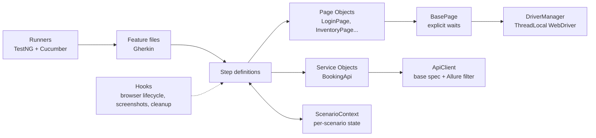

# API & Web Test Automation Framework


A BDD test automation framework covering **REST API** and **Web UI** testing, built with
Java, Cucumber, TestNG, RestAssured, Selenium and Allure, running in GitHub Actions.

The architecture is based on patterns I use day to day as a QA engineer on a mobile banking
product. I rebuilt them from scratch here against public demo applications.

| Layer | System under test |
|---|---|
| API | [Restful Booker](https://restful-booker.herokuapp.com/apidoc/index.html) - hotel booking REST API |
| Web | [Sauce Demo](https://www.saucedemo.com) - e-commerce web app |

---

## ✨ Highlights

- **BDD with Cucumber**: scenarios written in Gherkin and readable by non-engineers, with test case IDs as tags (`@TC-API-001`) for traceability to a test management tool
- **Page Object Model** for UI and **Service Object** for API, so each locator and endpoint is defined in exactly one place
- **Explicit waits only**: no `Thread.sleep`, and implicit wait is disabled (see [Waiting strategy](#-waiting-strategy))
- **Parallel execution**: one browser per thread via `ThreadLocal`, scenario state per thread via PicoContainer dependency injection
- **Automatic retry of failed scenarios**: the `rerun` plugin plus dedicated "Failed" runners
- **Self-cleaning API tests**: every booking created in a scenario is deleted in an `@After` hook
- **JSON Schema validation** of API responses
- **Screenshot on failure** attached to the report
- **CI pipeline**: dry-run gate, full run, retry, Allure report artifact, and nightly schedule
- **Config priority**: system property > environment variable > `config.properties`, so secrets never need to be committed

## 🏗️ Architecture



```
src
├── main/java
│   ├── core/            ConfigReader, DriverManager, BasePage
│   ├── pages/           Page Objects (Sauce Demo)
│   └── api/             ApiClient, BookingApi, models (Java records)
└── test
    ├── java
    │   ├── context/     ScenarioContext (DI-shared state), TestDataFactory
    │   ├── hooks/       WebHooks (@web), ApiHooks (@api)
    │   ├── steps/       api/ and web/ step definitions
    │   └── runners/     ApiRunner, WebRunner, Failed*Runner, DryRunRunner
    └── resources
        ├── features/    api/*.feature, web/*.feature
        ├── schemas/     JSON schemas
        └── config.properties
```

## 🧪 Test coverage

| ID | Area | Scenario | Type |
|---|---|---|---|
| TC-API-001 | Booking | Create booking (DataTable input, schema + body check) | Positive |
| TC-API-002 | Booking | Get booking by id | Positive |
| TC-API-003 | Booking | Search bookings by guest name | Positive |
| TC-API-004 | Booking | Full update (PUT) with token | Positive |
| TC-API-005 | Booking | Partial update (PATCH) with token | Positive |
| TC-API-006 | Booking | Update with invalid token → 403 | Negative |
| TC-API-007 | Booking | Delete booking, then verify 404 | Positive |
| TC-API-008 | Booking | Get non-existing booking → 404 | Negative |
| TC-API-009 | Auth | Create token with valid credentials | Positive |
| TC-API-010 | Auth | Invalid credentials (Scenario Outline, 3 cases) | Negative |
| TC-WEB-001 | Login | Successful login | Positive |
| TC-WEB-002 | Login | Locked / wrong / empty credentials (Scenario Outline, 4 cases) | Negative |
| TC-WEB-003 | Cart | Add one product | Positive |
| TC-WEB-004 | Cart | Add multiple products (DataTable) | Positive |
| TC-WEB-005 | Inventory | Sort by price low → high | Positive |
| TC-WEB-006 | Inventory | Sort by name Z → A | Positive |
| TC-WEB-007 | Checkout | End-to-end checkout | Positive |
| TC-WEB-008 | Checkout | Missing postal code | Negative |

**23 executable scenarios** in total (Scenario Outline examples included).

## ▶️ Running the tests

**Requirements:** JDK 21+, Maven 3.9+, Google Chrome. Browser drivers are downloaded automatically by Selenium Manager.

```bash
# Everything (API + Web), headless
mvn test

# Only one layer or tag
mvn test -Dcucumber.filter.tags="@api"
mvn test -Dcucumber.filter.tags="@web and @smoke"
mvn test -Dcucumber.filter.tags="@TC-WEB-007"

# Watch the browser
mvn test -Dcucumber.filter.tags="@web" -Dweb.headless=false

# Re-run only the scenarios that failed in the previous run
mvn test -Dsuite=testng-rerun.xml

# Check every step has a definition, without executing anything
mvn test -Dsuite=testng-dryrun.xml
```

### Reports

| Report | Location |
|---|---|
| Allure | `npx allure-commandline serve target/allure-results` |
| Cucumber HTML | `target/cucumber-reports/api.html`, `web.html` |
| CI | *Actions* tab → run → **Artifacts** (`allure-report`, `cucumber-reports`) |

## ⏱️ Waiting strategy

Flaky UI tests are usually caused by timing. This framework avoids fixed sleeps entirely:

- **Implicit wait = 0** and every interaction goes through `BasePage`, which waits for the exact condition it needs (visible, clickable).
- **Page load strategy = EAGER**: the test continues once the DOM is ready instead of waiting for slow third-party scripts. This removed renderer time-outs observed during parallel runs.
- **Stale element handling**: lists that re-render (e.g. after sorting) are read inside a wait that ignores `StaleElementReferenceException` and retries.

## 🔐 Configuration & secrets

`config.properties` contains only the **public demo credentials published by the demo sites**.
Any value can be overridden without touching the code:

```bash
mvn test -Dapi.base.url=https://staging.example.com      # system property
WEB_BROWSER=firefox mvn test                              # environment variable
```

For real projects, credentials belong in environment variables or CI secrets (`${{ secrets.X }}`), never in Git.

## 🔁 CI pipeline

`.github/workflows/ci.yml` runs on every push, pull request, manual trigger and nightly:

1. **Dry run**: fails fast if a Gherkin step has no implementation
2. **Full run**: API + Web in parallel, headless Chrome
3. **Retry**: failed scenarios are executed once more; only a second failure fails the build
4. **Reports**: Allure + Cucumber reports uploaded as artifacts (and published to GitHub Pages when the repo is public)

## 🗺️ Roadmap

- [ ] Mobile layer (Appium, Android) using the same Page Object / hook structure
- [ ] Cross-browser matrix (Chrome + Firefox) in CI
- [ ] Allure history trend across CI runs

---

Author: [@sultanmasbima](https://github.com/sultanmasbima)
